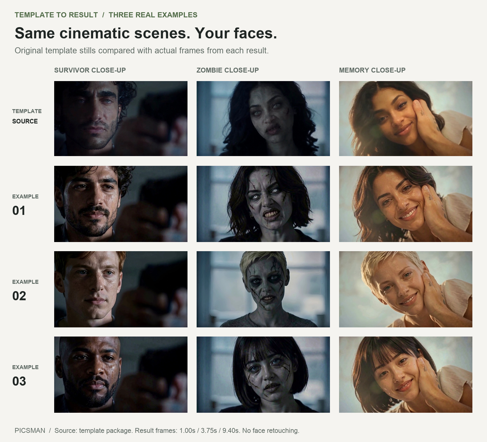
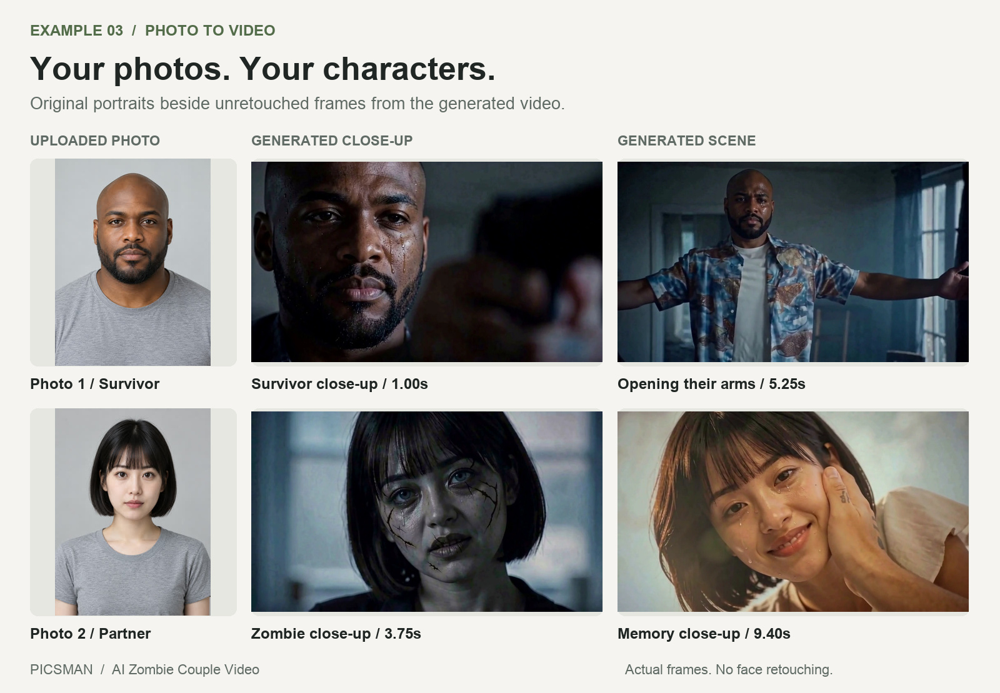
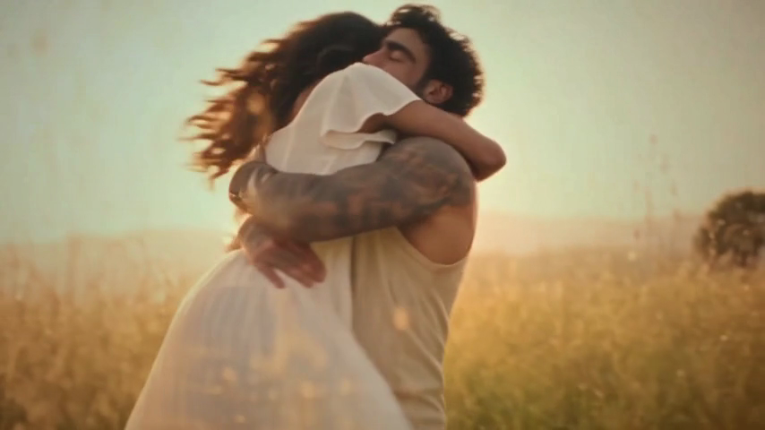
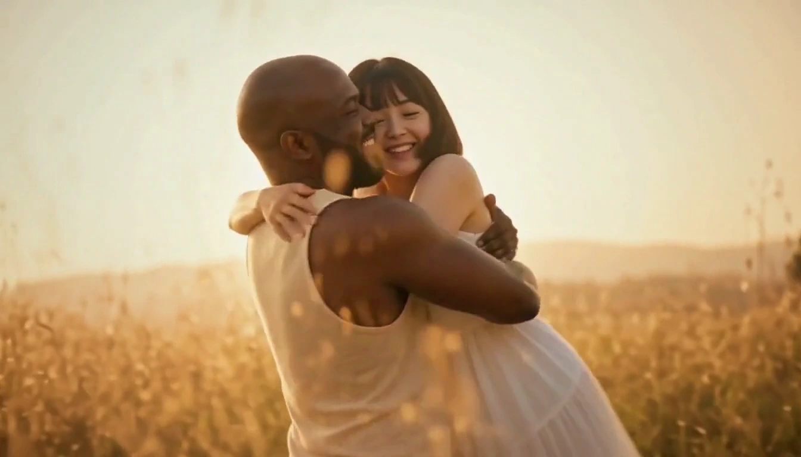
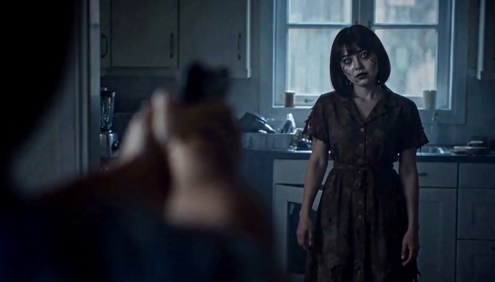
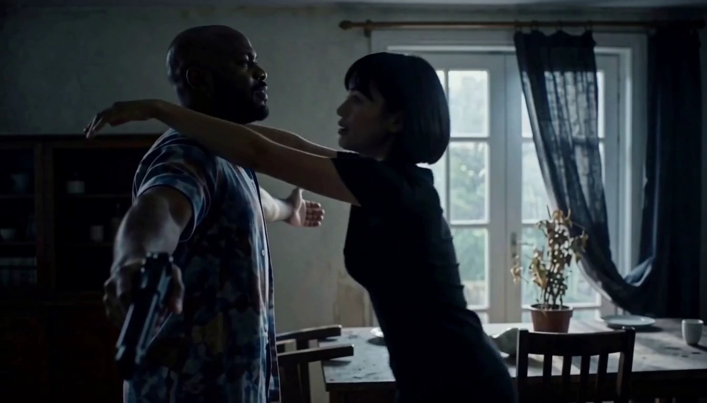
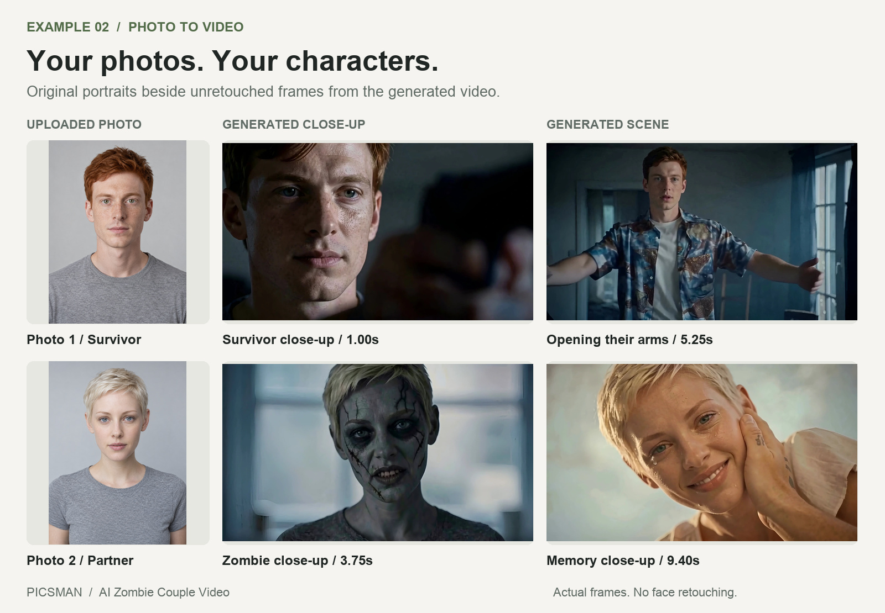

# How We Built an AI Zombie Couple Video Generator: Your Photos, the Same Cinematic Story

A tense encounter in a dark room. A familiar face transformed into a zombie. An embrace that leads into a sunlit reunion.

What if the two people in this story came from your own photos?

That is the experience we set out to build with the [Picsman AI Zombie Couple Video Generator](https://www.picsman.ai/tools/ai-video-generator/ai-zombie-couple-video): upload two portraits and become the leads in a cinematic short, with the reference scene’s atmosphere, actions, and emotional progression preserved.

Our approach combines character preparation, generation in shorter segments, and editing around the resulting actions. Here is what we learned and what the results look like.

**[Watch our latest video demonstration on YouTube →](https://youtu.be/bmQAEh4MBxw)**

The opening shows the reference and generated result playing side by side. Watch how the scene progresses as the cast changes.

## What we mean by scene fidelity

A convincing recreation needs to preserve several things at once.

| Quality | What we look for |
| --- | --- |
| Character identity | Recognizable facial features and hairstyle across close-ups, wider shots, and movement. |
| Scene fidelity | Composition, lighting, clothing, and surroundings that stay close to the reference. |
| Story continuity | Actions and emotional changes that connect into a coherent sequence. |

The comparison below shows reference stills above frames from three generated examples. Follow each column to compare the same kind of shot across different characters.

*Figure 1. Reference stills from the template and actual frames from the generated videos. Result frames were extracted without face retouching.*

The cast changes, while the dark encounter and warmer reunion remain recognizable. Framing and light help carry the original mood into each result.

## Two portraits become the characters

*Figure 2. Input portraits beside actual frames from one generated video.*

The survivor’s portrait has even lighting, a plain background, and a neutral expression. In the video, he appears under dramatic lighting with tears on his face. A wider shot shows the same character opening his arms inside the room, wearing the scene’s costume.

The partner appears both as a zombie and as a person in the warm reunion. Her short hair and bangs connect those appearances to the uploaded portrait.

The photos establish who the characters are. The reference establishes their surroundings and emotional context.

## What our early experiments taught us

Our early approach supplied the reference video and portraits together to generate the sequence. With multiple shots and characters, some outputs retained the reference actors’ appearance. Complex motion and partial occlusion made this especially difficult.

Portraits also contain clothing, backgrounds, and poses that may be unrelated to the target scene. Those details could influence the result unless we made the role of each reference clearer.

| What we observed | How we adjusted the approach |
| --- | --- |
| Reference actors remained in some shots. | Establish replacement characters in key scene images before generating motion. |
| Portrait clothing or composition influenced the scene. | Focus identity references on the head and shoulders, and preserve scene details separately. |
| Complex interactions weakened character consistency. | Generate shorter groups of shots and give difficult interactions more focused treatment. |
| Actions occurred at different times across outputs. | Assemble the sequence around the generated actions rather than relying entirely on fixed timestamps. |

These changes gave each stage a clearer task.

## Establish the characters before generating motion

We first prepare important scene images with the intended characters. This establishes how each person should appear under the scene’s lighting, within its composition, and with the appropriate expression.

Facial features and hairstyle come from the uploaded portrait. The scene supplies the framing, costume, environment, and emotional situation.

A tearful close-up should retain its tight framing and expression after the character changes. Importing the portrait’s neutral pose would weaken that moment.

The overall sequence is:

**Two portraits → Characters placed in key scenes → Motion segments → Finished story**

## Give complex interactions focused treatment

A close-up and a rotating embrace place different demands on generation. We organize the video into shorter segments so each has a more focused set of character and scene references.

During development, the sunlit embrace could revert toward the reference actors when placed later in a longer segment. Isolating it in a shorter segment improved replacement in our tested examples.

*Figure 3. An original reference keyframe retained in the development template.*

*Figure 4. A frame from the generated result with the new characters. Figures 3 and 4 show different moments in the embrace, rather than an exact frame match.*

This interaction combines two identities, physical contact, partial occlusion, and changing face angles. The result retains the sunlit setting and the embrace while bringing the new pair into the scene. The [video demonstration](https://youtu.be/bmQAEh4MBxw) makes the moving comparison easier to assess.

## Preserve continuity between story moments

Character consistency also needs to survive changes in distance and interaction.

*Figure 5. The encounter across the room, extracted from the generated video.*

*Figure 6. The same characters moving into an embrace later in the sequence.*

The window, curtains, and table help keep the setting recognizable while the characters move closer. We inspect successive shots to see whether identities, surroundings, and actions belong to the same story.

Timing matters here too. A generated character may pause longer before moving. A fixed cut can capture that pause instead of the intended contact. Assembly needs to preserve the meaningful action: opening the arms, approaching, and reaching the embrace.

## Check the result with a different cast

We also tested a red-haired survivor and a partner with short blonde hair.

*Figure 7. A second portrait pair in the cinematic sequence, using actual output frames.*

The same visual structure appears with a visibly different cast. Hair is particularly useful to inspect: a face can resemble the uploaded person while the hairstyle still comes from the reference actor. Checking both helps reveal incomplete replacements.

Our documented checks for the seven-shot template found character replacement across all seven shots in two distinct portrait pairs. That result describes those tested runs; repeatability across more inputs remains a separate evaluation.

We inspect stills for identity and composition, then watch the complete video for consistency through movement and transitions.

## Choose model capabilities around the task

We combine image-editing and video-generation capabilities, with a different purpose for each.

For image editing, we prioritize replacing the character while preserving the scene’s structure and expression. For video generation, we prioritize following the action reference and maintaining identity through motion and interaction.

Our selection criteria focus on recognizable characters, adherence to the scene, coherent movement, and usable output within reasonable generation time and cost.

The method is described here without naming individual models. Preparing the references, assigning their roles, and inspecting the assembled sequence all contribute to the final quality.

## Make the experience simple for the user

The underlying workflow prepares scene images, generates motion segments, and assembles the story. The user’s part is straightforward:

1. Upload a photo for each character.
2. Confirm the two roles.
3. Generate the video.

Users do not need to prepare keyframes, write prompts for individual shots, or edit the segments themselves. The template turns that work into a way to put two familiar faces into a cinematic story.

**[Create your AI Zombie Couple video with Picsman →](https://www.picsman.ai/tools/ai-video-generator/ai-zombie-couple-video)**

Watch the [latest YouTube demonstration](https://youtu.be/bmQAEh4MBxw) for the moving comparisons, or follow the [step-by-step tutorial](https://www.picsman.ai/blog/how-to-make-ai-zombie-couple-video/) to make your own.
